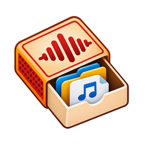
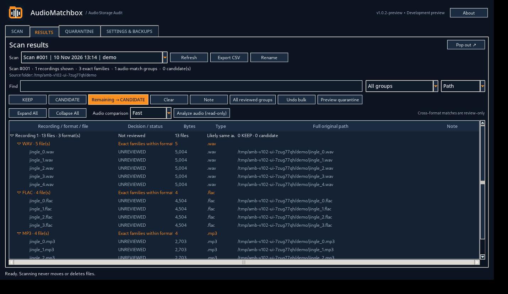

  

  # AudioMatchbox
  **Review duplicate audio. Protect the files that matter.**

  Windows audio-storage audit tool · Development preview v1.0.5 · Closed source

AudioMatchbox is a desktop application for discovering repeated audio files in large media libraries while keeping deletion decisions in human hands. It was designed around a practical broadcast-engineering problem: a shared jingle or clip gets copied across projects, and eventually hundreds of nearly indistinguishable files occupy storage—some of which remain referenced by operational systems.

## What it does

- **Exact duplicate scanning:** SHA-256 identifies byte-for-byte copies across names and directories.
- **Cross-format analysis:** optional read-only WAV/FLAC/MP3 similarity suggestions using separately installed FFmpeg/FFprobe; a similar recording is **not** an automatically deletable duplicate.
- **Unified results:** review recordings as an expandable tree with format-specific copies, scalable filtering, and large-group pagination.
- **Human-reviewed protection:** manually mark one or more protected **KEEP** files in each exact-duplicate family; select remaining exact copies as **CANDIDATE**.
- **Reversible quarantine:** preview and approve moves, retain original paths, review session history, and selectively restore individual files.
- **Safer disposal:** active quarantined copies can be sent to the Windows Recycle Bin, with audit status and no silent permanent-deletion fallback.
- **Persistent reviews:** SQLite stores scan history, review decisions, notes, CSV exports, and database backups. Metadata backups do not contain quarantined audio.

## Development screenshot

*Screenshot from an earlier UI development test with disposable synthetic audio on Linux. v1.0.5 has subsequent layout, dropdown, and Recycle Bin changes; real Windows appearance differs.*

## Workflow

1. Choose an audio folder and scan for exact duplicates; optionally enable Fast/Thorough cross-format analysis.
2. Expand a recording to inspect WAV/FLAC/MP3 families and their original paths.
3. Mark files to protect as KEEP and review other exact-byte copies as CANDIDATE.
4. Preview a proposed quarantine operation. No files move until separately approved.
5. Restore selected quarantined files, or send active quarantine entries to the Windows Recycle Bin, keeping the audit history.

## Technology

| Layer | Implementation |
| --- | --- |
| Desktop UI | Python, Tkinter |
| Data and audit | SQLite |
| Exact matching | SHA-256 |
| Decoded audio similarity | FFmpeg/FFprobe and sampled correlation (optional) |
| Safety | Manual KEEP validation, file-hash checks, reversible quarantine, restoration, Recycle Bin |
| Distribution plan | Windows `.exe` built with PyInstaller, pending acceptance testing |

## Project status

**v1.0.5 development preview — 10 November 2026.** The project passed 43 automated tests in its development environment. Windows stress, portability, large-library, cross-format, icon/DPI and Recycle Bin acceptance testing remains ongoing. This is **not certified for production broadcast storage**, and an executable is not publicly distributed yet.

See [Release notes](RELEASE_NOTES_v1.0.5.md), [Change history](CHANGELOG.md), and [Roadmap](ROADMAP.md).

## Development and ownership

AudioMatchbox is developed as an independently managed software project by **Omar Zeineddine**. The implementation is maintained privately while potential commercial licensing is evaluated. This public repository is intended as a project portfolio and status page; it deliberately does **not** include source code, private audio, databases, quarantine archives or executable downloads.

Copyright © 2026 Omar Zeineddine. All rights reserved. No public software-use or redistribution license is offered here.
